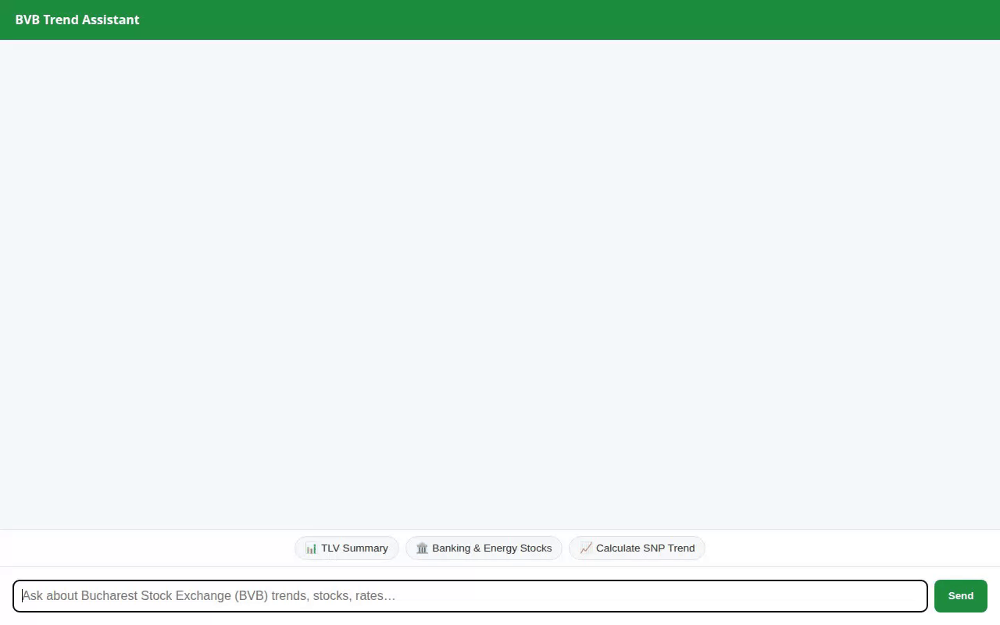

# BVB Trend Assistant



**BVB Trend Assistant** is an AI-powered financial advisor and analytics platform designed for equities and ETFs listed on the Bucharest Stock Exchange (BVB / BSE). The agent provides real-time stock and ETF database lookups, technical indicator calculations (RSI momentum, ratings), live currency exchange conversions (RON <-> EUR/USD), durable user memory persistence, dynamic A2UI visual cards, AI-generated infographic badges, and animated stock trend video generation.

---

## 🚀 Key Features & Implemented Capabilities

The agent is built on the **Google Agent Development Kit (ADK)** and integrates with the following Google Cloud services and tools:

* **Vertex AI Memory Bank**: Uses `PreloadMemoryTool` and `generate_memories_callback` (`add_session_to_memory`) to automatically extract, store, and recall user investment goals, risk tolerance, and portfolio holdings across chat sessions.
* **Google Cloud Firestore (`bvb_stocks`)**: Queries a structured database of Bucharest Stock Exchange equities and ETFs (e.g., `TLV`, `SNP`, `H2O`, `TVBETETF`, `BRD`, `DIGI`, `TGN`, `TEL`, `ONE`, `FP`) to retrieve P/E ratios, dividend yields, market prices, sectors, asset types, and trend signals.
* **Google Cloud Storage (GCS)**: Stores generated stock trend images and videos in a public bucket for public HTTPS distribution.
* **Gemini Image Generation (`gemini-3.1-flash-lite-image`)**: `generate_stock_trend_image` generates visual stock trend infographic badge images in the `global` region, saves them as ADK artifacts, and uploads them to Cloud Storage.
* **Gemini Omni Video Generation (`gemini-omni-flash-preview`)**: `generate_stock_trend_video` generates short animated market trend videos in the `global` region using the Vertex AI Interactions API, saves them as ADK artifacts, and uploads them to Cloud Storage.
* **A2UI Schema Manager (v0.8)**: Generates structured A2UI UI payloads (Cards, Columns, Rows, Text, Images) for rich visual rendering in the chat interface.
* **Agent Engine Sandbox Code Executor**: `AgentEngineSandboxCodeExecutor` safely executes Python code in a sandbox environment for financial modeling and statistical calculations.
* **Live ECB Currency Rates**: `get_ron_exchange_rates` fetches live European Central Bank exchange rates for RON <-> EUR/USD conversions.
* **Technical Indicator Engine**: `calculate_technical_indicators` computes RSI momentum, moving averages, and technical ratings for BVB assets.
* **Stock Trend Updates**: `update_stock_trend` updates asset trend signals (`Bullish`, `Bearish`, `Neutral`) in Firestore.

---

## 📁 Repository Structure

```
bvb-trend-assistant/
├── app/                        # Agent backend logic
│   ├── agent.py                # Main agent definition, instruction prompt, & tool wiring
│   ├── tools.py                # Firestore, GCS, Gemini image/video, & technical indicator tools
│   └── a2ui_utils.py           # Callback to structure model responses into A2UI JSON
├── frontend/                   # Web interface and proxy
│   ├── main.py                 # FastAPI proxy forwarding chat messages via A2A protocol
│   ├── static/
│   │   └── index.html          # Chat interface with green theme and tailored prompt chips
│   ├── Dockerfile              # Container spec for frontend Cloud Run deployment
│   └── requirements.txt        # Frontend proxy Python dependencies
├── agents-cli-manifest.yaml   # Manifest for Agent Runtime deployment
├── deployment_metadata.json    # Agent Engine resource mapping
└── demo.gif                    # Animated demonstration recording
```

---

## 🛠️ Setup and Local Execution

### Prerequisites

1. **Python 3.10+**
2. **Google Cloud SDK**: Configured with Application Default Credentials (`gcloud auth application-default login`).
3. **GCP Project Permissions**: Access to Vertex AI, Firestore, and Cloud Storage in project `qwiklabs-gcp-01-e13c31e58e65`.

### 1. Install Backend Dependencies

```bash
pip install -r app/requirements.txt
```

### 2. Run Local Frontend Proxy

To run the web interface locally, set the deployment environment variables and start `main.py`:

```bash
cd frontend
pip install -r requirements.txt

export AGENT_ENGINE_RESOURCE_NAME="projects/798218987654/locations/us-east1/reasoningEngines/4742520205551337472"
export AGENT_DIRECTORY="app"

python main.py
```

The application will start locally on port `8080`.

---

## ☁️ Deployment Commands

### Deploy Agent to Agent Runtime

To deploy or update the agent on Agent Platform:

```bash
agents-cli deploy --no-confirm-project
```

### Deploy Frontend to Cloud Run

To build and deploy the frontend proxy to Cloud Run:

```bash
cd frontend
gcloud run deploy bvb-trend-assistant-frontend \
  --source . \
  --region us-east1 \
  --allow-unauthenticated \
  --set-env-vars AGENT_ENGINE_RESOURCE_NAME="projects/798218987654/locations/us-east1/reasoningEngines/4742520205551337472",AGENT_DIRECTORY="app"
```
